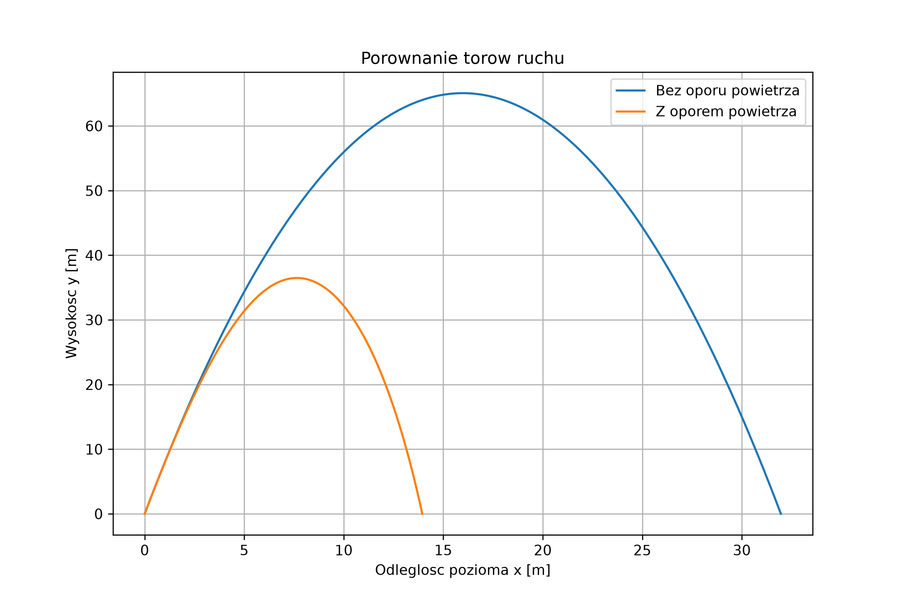
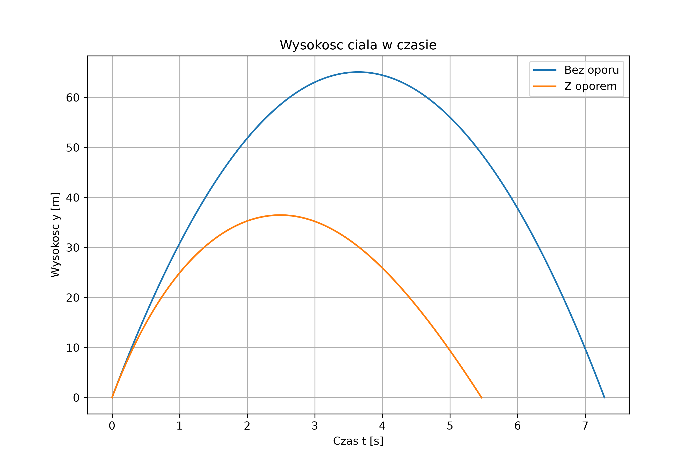
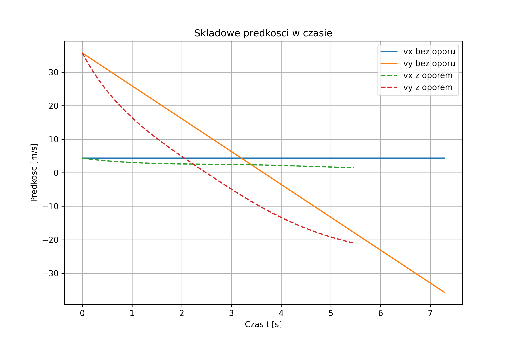

# Analiza rzutu ukośnego bez oporu powietrza oraz z uwzględnieniem oporu powietrza

**Przedmiot:** Programy Użytkowe  
**Temat:** Rzut ukośny – analiza teoretyczna i numeryczna  
**Parametry początkowe:**
- Prędkość początkowa: $v_0 = 36\,\mathrm{m/s}$
- Kąt wyrzutu: $\alpha = 83^\circ$
- Przyspieszenie ziemskie: $g = 9{,}81\,\mathrm{m/s^2}$

---

## Spis treści

1. Wstęp
2. Założenia i model fizyczny
3. Rzut ukośny bez oporu powietrza
4. Analiza matematyczna ruchu
5. Rzut ukośny z oporem powietrza
6. Symulacja numeryczna w języku Python
7. Porównanie obu modeli
8. Analiza wykresów
9. Wnioski

---

## 1. Wstęp

Rzut ukośny jest jednym z podstawowych przykładów ruchu w polu grawitacyjnym. Polega na nadaniu ciału prędkości początkowej skierowanej pod określonym kątem względem poziomu.

Ruch ten można rozłożyć na dwa niezależne ruchy:
- ruch jednostajny w kierunku poziomym,
- ruch jednostajnie zmienny w kierunku pionowym.

W rzeczywistych warunkach na poruszające się ciało działa również opór powietrza. Powoduje on zmniejszenie prędkości, skrócenie zasięgu oraz zmianę kształtu toru ruchu.

Celem niniejszego raportu jest przedstawienie matematycznego opisu rzutu ukośnego w dwóch przypadkach: bez uwzględnienia oporu powietrza oraz z jego uwzględnieniem. Dodatkowo przeprowadzona zostanie symulacja komputerowa pozwalająca porównać oba modele.

## 2. Założenia i model fizyczny

W celu uproszczenia analizy przyjęto następujące założenia:

1. Ciało traktowane jest jako punkt materialny.
2. Ruch odbywa się w jednorodnym polu grawitacyjnym Ziemi.
3. Przyspieszenie ziemskie jest stałe i wynosi $9{,}81\,\mathrm{m/s^2}$.
4. Początkowa wysokość wyrzutu wynosi zero.
5. Prędkość początkowa wynosi $36\,\mathrm{m/s}$.
6. Kąt wyrzutu wynosi $83^\circ$.
7. W modelu z oporem powietrza przyjęto opór proporcjonalny do kwadratu prędkości.

### 2.1. Wielkości fizyczne i jednostki SI

| Wielkość | Symbol | Jednostka |
|---|---|---|
| Położenie poziome | x | m |
| Położenie pionowe | y | m |
| Czas | t | s |
| Prędkość | v | m/s |
| Przyspieszenie | a | m/s² |
| Przyspieszenie ziemskie | g | m/s² |
| Masa | m | kg |
| Siła | F | N |
| Kąt wyrzutu | α | rad lub ° |

## 3. Rzut ukośny bez oporu powietrza

W przypadku pominięcia oporu powietrza na ciało działa wyłącznie siła ciężkości. Zgodnie z drugą zasadą dynamiki Newtona:

$$
\vec{F}=m\vec{a}
$$

Siła ciężkości ma postać:

$$
\vec{F}_g=m\vec{g}
$$

Przyjmując układ współrzędnych, w którym oś X jest skierowana poziomo, a oś Y pionowo w górę, otrzymujemy:

$$
a_x=0
$$

$$
a_y=-g
$$

### 3.1. Rozkład prędkości początkowej na składowe

Prędkość początkową można rozłożyć na dwie składowe:

$$
v_{0x}=v_0\cos\alpha
$$

$$
v_{0y}=v_0\sin\alpha
$$

Dla przyjętych parametrów:

$$
v_{0x}=36\cos83^\circ
$$

$$
v_{0x}\approx4{,}39\,\mathrm{m/s}
$$

Analogicznie:

$$
v_{0y}=36\sin83^\circ
$$

$$
v_{0y}\approx35{,}73\,\mathrm{m/s}
$$

### 3.2. Równania prędkości

W kierunku poziomym nie występuje przyspieszenie, dlatego prędkość pozostaje stała:

$$
v_x(t)=v_0\cos\alpha
$$

W kierunku pionowym działa przyspieszenie ziemskie skierowane w dół:

$$
v_y(t)=v_0\sin\alpha-gt
$$

### 3.3. Równania położenia

Korzystając z zależności między prędkością a położeniem, otrzymujemy równania ruchu.

W kierunku poziomym:

$$
x(t)=v_0\cos\alpha\cdot t
$$

W kierunku pionowym:

$$
y(t)=v_0\sin\alpha\cdot t-\frac{1}{2}gt^2
$$

Powyższe równania opisują położenie ciała w dowolnej chwili czasu.

### 3.4. Czas wznoszenia

W najwyższym punkcie toru składowa pionowa prędkości jest równa zero:

$$
v_y(t)=0
$$

Zatem:

$$
v_0\sin\alpha-gt=0
$$

Po przekształceniu:

$$
t_w=\frac{v_0\sin\alpha}{g}
$$

Podstawiając dane:

$$
t_w=\frac{36\sin83^\circ}{9{,}81}
$$

Ostatecznie:

$$
t_w\approx3{,}64\,\mathrm{s}
$$

### 3.5. Maksymalna wysokość

Maksymalną wysokość można obliczyć, podstawiając czas wznoszenia do równania pionowego:

$$
H_{\max}=v_0\sin\alpha\cdot t_w-\frac{1}{2}gt_w^2
$$

Po uproszczeniu otrzymujemy:

$$
H_{\max}=\frac{v_0^2\sin^2\alpha}{2g}
$$

Dla analizowanego przypadku:

$$
H_{\max}=\frac{36^2\sin^283^\circ}{2\cdot9{,}81}
$$

Ostatecznie:

$$
H_{\max}\approx65{,}07\,\mathrm{m}
$$

### 3.6. Całkowity czas lotu

Zakładając, że ciało ląduje na tej samej wysokości, z której zostało wyrzucone, całkowity czas lotu jest dwukrotnością czasu wznoszenia:

$$
T=2t_w
$$

$$
T=\frac{2v_0\sin\alpha}{g}
$$

Ostatecznie:

$$
T\approx7{,}28\,\mathrm{s}
$$

### 3.7. Zasięg rzutu

Zasięg poziomy to odległość, jaką ciało pokonuje w kierunku poziomym podczas całego lotu.

$$
R=v_0\cos\alpha\cdot T
$$

Po podstawieniu wzoru na czas lotu:

$$
R=\frac{v_0^2\sin(2\alpha)}{g}
$$

Dla przyjętych parametrów:

$$
R=\frac{36^2\sin166^\circ}{9{,}81}
$$

Ostatecznie:

$$
R\approx31{,}96\,\mathrm{m}
$$

## 4. Rzut ukośny z oporem powietrza

W rzeczywistych warunkach ruch ciała odbywa się w ośrodku materialnym, takim jak powietrze. Powoduje to występowanie dodatkowej siły oporu, która działa przeciwnie do kierunku prędkości ciała.

W niniejszym raporcie przyjęto model oporu proporcjonalnego do kwadratu wartości prędkości.

### 4.1. Siła oporu powietrza

Siłę oporu aerodynamicznego opisuje wzór:

$$
F_o=\frac{1}{2}\rho C_d A v^2
$$

gdzie:

- $\rho$ – gęstość powietrza $[\mathrm{kg/m^3}]$,
- $C_d$ – współczynnik oporu aerodynamicznego,
- $A$ – powierzchnia przekroju poprzecznego ciała $[\mathrm{m^2}]$,
- $v$ – wartość prędkości ciała $[\mathrm{m/s}]$.

Siła oporu jest skierowana przeciwnie do wektora prędkości. Jej zapis wektorowy ma postać:

$$
\vec{F}_o=-\frac{1}{2}\rho C_d A v\vec{v}
$$

Wprowadzając pomocnicze oznaczenie:

$$
k=\frac{1}{2}\rho C_d A
$$

otrzymujemy uproszczony zapis:

$$
\vec{F}_o=-kv\vec{v}
$$

### 4.2. Równania ruchu z oporem powietrza

Zgodnie z drugą zasadą dynamiki Newtona na ciało działa suma siły ciężkości oraz siły oporu powietrza:

$$
m\vec{a}=\vec{F}_g+\vec{F}_o
$$

Rozpatrując osobno obie osie współrzędnych, otrzymujemy:

$$
m\frac{dv_x}{dt}=-kvv_x
$$

$$
m\frac{dv_y}{dt}=-mg-kvv_y
$$

Dzieląc równania przez masę ciała:

$$
\frac{dv_x}{dt}=-\frac{k}{m}vv_x
$$

$$
\frac{dv_y}{dt}=-g-\frac{k}{m}vv_y
$$

Wartość prędkości wypadkowej wyznaczamy z twierdzenia Pitagorasa:

$$
v=\sqrt{v_x^2+v_y^2}
$$

Otrzymujemy układ czterech równań różniczkowych opisujących cały ruch:

$$
\frac{dx}{dt}=v_x
$$

$$
\frac{dy}{dt}=v_y
$$

$$
\frac{dv_x}{dt}=-\frac{k}{m}\sqrt{v_x^2+v_y^2}\,v_x
$$

$$
\frac{dv_y}{dt}=-g-\frac{k}{m}\sqrt{v_x^2+v_y^2}\,v_y
$$

W przeciwieństwie do modelu bez oporu powietrza, powyższe równania są nieliniowe. Oznacza to, że nie można bezpośrednio zastosować prostych wzorów na czas lotu i zasięg.

### 4.3. Parametry symulacji

Do przeprowadzenia symulacji przyjęto następujące wartości:

| Parametr | Symbol | Wartość | Jednostka |
|---|---|---:|---|
| Masa ciała | m | 0,20 | kg |
| Gęstość powietrza | ρ | 1,225 | kg/m³ |
| Współczynnik oporu | C<sub>d</sub> | 0,47 | - |
| Powierzchnia przekroju | A | 0,01 | m² |
| Prędkość początkowa | v₀ | 36 | m/s |
| Kąt wyrzutu | α | 83 | ° |
| Przyspieszenie ziemskie | g | 9,81 | m/s² |

Przyjęte parametry odpowiadają uproszczonemu modelowi niewielkiego kulistego ciała poruszającego się w powietrzu.

Wartość współczynnika oporu jest przybliżona i w rzeczywistości może zależeć od kształtu ciała oraz warunków przepływu powietrza.

### 4.4. Warunki początkowe

Na początku symulacji ciało znajduje się w punkcie początkowym układu współrzędnych:

$$
x(0)=0
$$

$$
y(0)=0
$$

Początkowe składowe prędkości wynoszą:

$$
v_x(0)=v_0\cos\alpha
$$

$$
v_y(0)=v_0\sin\alpha
$$

Dla przyjętych parametrów:

$$
v_x(0)\approx4{,}39\,\mathrm{m/s}
$$

$$
v_y(0)\approx35{,}73\,\mathrm{m/s}
$$

### 4.5. Metoda rozwiązania numerycznego

Ze względu na nieliniowy charakter równań różniczkowych zastosowana zostanie metoda numeryczna. W symulacji wykorzystany będzie algorytm Rungego-Kutty czwartego rzędu (RK4).

Metoda ta pozwala przybliżać rozwiązania układów równań różniczkowych poprzez obliczanie kolejnych wartości funkcji w niewielkich odstępach czasu.

W symulacji przyjęty zostanie krok czasowy:

$$
\Delta t=0{,}01\,\mathrm{s}
$$

Obliczenia będą wykonywane aż do momentu zetknięcia ciała z podłożem, czyli osiągnięcia warunku:

$$
y(t)\leq 0
$$

Dzięki temu możliwe będzie wyznaczenie toru ruchu, czasu lotu oraz zasięgu rzutu z uwzględnieniem oporu powietrza.

Poniższy kod zawiera parametry wejściowe, obliczenia obu modeli oraz generowanie wszystkich wykresów:

```python
import math
from pathlib import Path

import matplotlib.pyplot as plt

v0 = 36.0
alpha = 83.0
g = 9.81

m = 0.20
rho = 1.225
Cd = 0.47
A = 0.01
dt = 0.01

alpha_rad = math.radians(alpha)
k = 0.5 * rho * Cd * A
vx0 = v0 * math.cos(alpha_rad)
vy0 = v0 * math.sin(alpha_rad)

output_dir = Path("wykresy")
output_dir.mkdir(exist_ok=True)

def simulate_without_drag():
    times = [0.0]
    xs = [0.0]
    ys = [0.0]
    vxs = [vx0]
    vys = [vy0]
    t = 0.0

    while True:
        next_t = t + dt
        next_y = vy0 * next_t - 0.5 * g * next_t**2

        if next_y <= 0:
            fraction = ys[-1] / (ys[-1] - next_y)
            landing_t = t + fraction * dt
            times.append(landing_t)
            xs.append(vx0 * landing_t)
            ys.append(0.0)
            vxs.append(vx0)
            vys.append(vy0 - g * landing_t)
            break

        t = next_t
        times.append(t)
        xs.append(vx0 * t)
        ys.append(next_y)
        vxs.append(vx0)
        vys.append(vy0 - g * t)

    return times, xs, ys, vxs, vys

def derivatives(state):
    x, y, vx, vy = state
    speed = math.sqrt(vx**2 + vy**2)
    ax = -(k / m) * speed * vx
    ay = -g - (k / m) * speed * vy
    return [vx, vy, ax, ay]

def rk4_step(state, dt):
    k1 = derivatives(state)
    s2 = [state[i] + 0.5 * dt * k1[i] for i in range(4)]
    k2 = derivatives(s2)
    s3 = [state[i] + 0.5 * dt * k2[i] for i in range(4)]
    k3 = derivatives(s3)
    s4 = [state[i] + dt * k3[i] for i in range(4)]
    k4 = derivatives(s4)
    return [
        state[i] + (dt / 6)
        * (k1[i] + 2*k2[i] + 2*k3[i] + k4[i])
        for i in range(4)
    ]

def simulate_with_drag():
    t = 0.0
    state = [0.0, 0.0, vx0, vy0]
    times = [t]
    xs = [0.0]
    ys = [0.0]
    vxs = [vx0]
    vys = [vy0]

    while True:
        next_state = rk4_step(state, dt)

        if next_state[1] <= 0:
            fraction = state[1] / (state[1] - next_state[1])
            landing_state = [
                state[i] + fraction * (next_state[i] - state[i])
                for i in range(4)
            ]
            t += fraction * dt
            times.append(t)
            xs.append(landing_state[0])
            ys.append(0.0)
            vxs.append(landing_state[2])
            vys.append(landing_state[3])
            break

        state = next_state
        t += dt
        times.append(t)
        xs.append(state[0])
        ys.append(state[1])
        vxs.append(state[2])
        vys.append(state[3])

    return times, xs, ys, vxs, vys

t1, x1, y1, vx1, vy1 = simulate_without_drag()
t2, x2, y2, vx2, vy2 = simulate_with_drag()

plt.figure(figsize=(9, 6))
plt.plot(x1, y1, label="Bez oporu powietrza")
plt.plot(x2, y2, label="Z oporem powietrza")
plt.title("Porownanie torow ruchu")
plt.xlabel("Odleglosc pozioma x [m]")
plt.ylabel("Wysokosc y [m]")
plt.legend()
plt.grid()
plt.savefig(output_dir / "tor_ruchu.png", dpi=300)
plt.close()

plt.figure(figsize=(9, 6))
plt.plot(t1, y1, label="Bez oporu")
plt.plot(t2, y2, label="Z oporem")
plt.title("Wysokosc ciala w czasie")
plt.xlabel("Czas t [s]")
plt.ylabel("Wysokosc y [m]")
plt.legend()
plt.grid()
plt.savefig(output_dir / "wysokosc_czas.png", dpi=300)
plt.close()

plt.figure(figsize=(9, 6))
plt.plot(t1, vx1, label="vx bez oporu")
plt.plot(t1, vy1, label="vy bez oporu")
plt.plot(t2, vx2, "--", label="vx z oporem")
plt.plot(t2, vy2, "--", label="vy z oporem")
plt.title("Skladowe predkosci w czasie")
plt.xlabel("Czas t [s]")
plt.ylabel("Predkosc [m/s]")
plt.legend()
plt.grid()
plt.savefig(output_dir / "predkosc_czas.png", dpi=300)
plt.close()

print("Wyniki bez oporu:", t1[-1], x1[-1], max(y1))
print("Wyniki z oporem:", t2[-1], x2[-1], max(y2))
```

Pełna implementacja symulacji znajduje się w pliku [symulacja.py](./symulacja.py).

## 5. Wyniki symulacji

### 5.1. Porównanie wyników

| Model | Czas lotu [s] | Zasięg [m] | Maksymalna wysokość [m] |
|---|---:|---:|---:|
| Bez oporu powietrza | 7,28 | 31,96 | 65,07 |
| Z oporem powietrza | 5,47 | 13,94 | 36,49 |

W modelu z oporem powietrza czas lotu, zasięg i maksymalna wysokość są mniejsze niż w modelu idealnym.

### 5.2. Analiza toru ruchu



Wykres przedstawia porównanie trajektorii ciała w przypadku pominięcia oporu powietrza oraz przy jego uwzględnieniu.

W modelu idealnym tor ruchu ma kształt paraboli. W przypadku uwzględnienia oporu powietrza zasięg oraz maksymalna wysokość są mniejsze.

### 5.3. Zależność wysokości od czasu



Wykres przedstawia zmianę wysokości ciała w czasie. W obu przypadkach ciało początkowo wznosi się, osiąga maksymalną wysokość, a następnie opada.

Uwzględnienie oporu powietrza powoduje zmniejszenie maksymalnej wysokości oraz zmianę czasu trwania poszczególnych etapów ruchu.

### 5.4. Zależność prędkości od czasu



Wykres przedstawia zmiany poziomej i pionowej składowej prędkości.

Bez oporu powietrza składowa pozioma prędkości pozostaje stała, natomiast składowa pionowa zmienia się liniowo pod wpływem przyspieszenia ziemskiego.

W przypadku uwzględnienia oporu powietrza obie składowe prędkości ulegają zmianom, ponieważ siła oporu działa przeciwnie do kierunku ruchu.